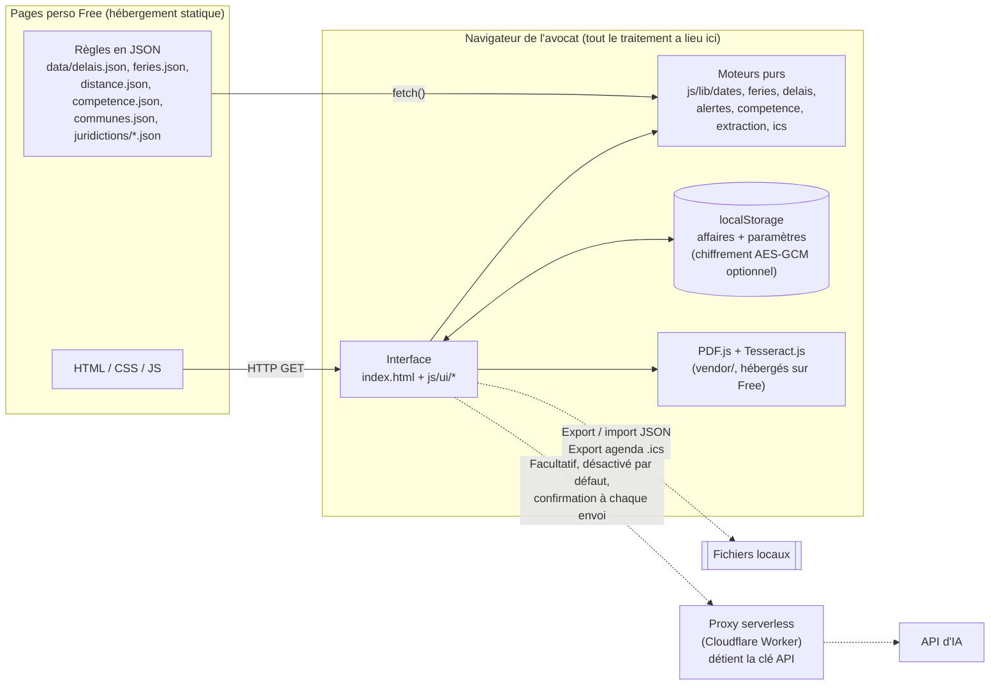

# 1. Architecture

## 1.1 Schéma général



Version ASCII :

```
┌──────────── Pages perso Free (statique) ────────────┐
│ index.html  css/  js/  data/*.json  vendor/          │
└──────────────────────┬───────────────────────────────┘
                       │ HTTP (fichiers seulement, aucune donnée client)
┌──────────────────────▼───────── Navigateur ──────────────────────────┐
│  UI (js/ui)  ──►  moteurs purs (js/lib)  ◄── règles JSON (data/)      │
│     │                                                                 │
│     ├──► localStorage (affaires, paramètres ; chiffrement optionnel)  │
│     ├──► PDF.js / Tesseract.js : lecture et OCR des actes, en local   │
│     └──► fichiers : sauvegarde JSON, agenda .ics                      │
└─────────────────────┬────────────────────────────────────────────────┘
                      ┆ facultatif : texte extrait → proxy (clé API) → IA
```

## 1.2 Arborescence

```
procivil/
├── index.html                 Application (routage par ancre #/…)
├── tests.html                 Exécution du jeu de tests dans le navigateur
├── css/style.css              Styles (thème clair/sombre, mobile)
├── js/
│   ├── app.js                 Démarrage, chargement des règles, routeur
│   ├── storage.js             localStorage, export/import, fusion
│   ├── crypto.js              Chiffrement optionnel (WebCrypto)
│   ├── model.js               Affaires, actes, délais, frise, démo
│   ├── lib/                   Logique pure, sans DOM, testée sous Node
│   │   ├── dates.js           Dates civiles ISO, art. 641 al. 2 (fin de mois)
│   │   ├── feries.js          Pâques, fêtes mobiles, zones (Alsace-Moselle, DROM)
│   │   ├── delais.js          Art. 640 à 642, 643, 644, 647 CPC, interruption AJ
│   │   ├── alertes.js         Seuils, niveaux, tri par priorité
│   │   ├── competence.js      Arbre de décision, communes, juridictions
│   │   ├── extraction.js      Repérage des dates, parties, juridiction (regex)
│   │   └── ics.js             Export iCalendar
│   └── ui/                    Vues : dashboard, fiche, settings, nouvelle,
│                              calculateur, competence, document, composants, dom
├── data/                      RÈGLES JURIDIQUES (modifiables sans toucher au code)
│   ├── delais.json            Catalogue des délais et des actes
│   ├── feries.json            Jours fériés nationaux et locaux
│   ├── distance.json          Délais de distance (art. 643-644)
│   ├── competence.json        Arbre de compétence matérielle et territoriale
│   ├── communes.json          35 014 communes (COG INSEE), 1,3 Mo
│   ├── juridictions/echantillon.json  Commune → juridictions (démonstration)
│   └── demo.json              4 affaires fictives
├── vendor/                    PDF.js 6.4, Tesseract.js 7 + modèle français
├── tests/                     cas.js (partagé), run-node.mjs
├── tools/                     Scripts de génération des données
├── proxy/cloudflare-worker.js Proxy IA facultatif
└── docs/                      Documentation (ce dossier)
```

## 1.3 Modèle de données

Tout l'état tient dans un objet JSON, enregistré dans `localStorage` (clé `procivil.v1`) et exporté tel quel.

```json
{
  "format": "procivil",
  "version": 1,
  "exporteLe": "2026-10-16T09:12:00.000Z",
  "parametres": {
    "seuils": { "rouge": 3, "orange": 7 },
    "joursChomes": [ { "date": "2026-12-24", "libelle": "Greffe fermé" } ],
    "chiffrement": false,
    "ia": { "active": false, "urlProxy": "", "jeton": "" },
    "derniereSauvegarde": "2026-10-16T09:12:00.000Z",
    "demoChargee": true
  },
  "affaires": [ {
    "id": "aff_mgt3k2a1b2c3d4",
    "nom": "Martin c/ SARL Bâtiments du Rhône",
    "reference": "2025-118",
    "rg": "24/04512",
    "parties": { "demandeur": "M. Paul Martin", "defendeur": "SARL Bâtiments du Rhône", "communeDefendeur": null },
    "client": "defendeur",
    "juridiction": {
      "libelle": "Tribunal judiciaire", "code": "TJ", "nomPrecis": "Tribunal judiciaire de Lyon",
      "commune": { "insee": "69123", "nom": "Lyon", "dep": "69" },
      "rattachement": "Commune du domicile du défendeur",
      "fondements": [ { "article": "art. L. 211-3 COJ", "texte": "…" }, { "article": "art. 42 CPC", "texte": "…" } ],
      "determineLe": "2026-10-16", "coursAppel": "Cour d'appel de Lyon"
    },
    "contexte": { "lieuJuridiction": "metropole", "zoneFeries": "metropole", "residence": "metropole" },
    "statut": "en_cours",
    "seuils": null,
    "notes": "",
    "actes": [ {
      "id": "acte_…", "type": "signification_jugement", "libelle": "Signification du jugement",
      "date": "2026-09-18", "commentaire": "", "source": "manuel",
      "document": null
    } ],
    "delais": [ {
      "id": "del_…", "typeId": "appel_contentieux", "libelle": "Appel d'un jugement contentieux",
      "article": "art. 538 CPC", "acteId": "acte_…", "dateDepart": "2026-09-18",
      "residence": null, "notifieSurPlace": false, "interruption": null,
      "duree": null, "sens": null, "dateImposee": null,
      "statut": "a_faire", "accompliLe": null,
      "echeance": "2026-10-19",
      "calcul": { "echeanceBrute": "2026-10-18", "etapes": [ { "article": "art. 642 al. 2 CPC", "texte": "…" } ], "avertissements": [], "distance": null, "verifie": true }
    } ],
    "creeLe": "…", "modifieLe": "…"
  } ]
}
```

Points de conception :

- **Un délai référence l'acte qui le fait courir** (`acteId`). Modifier la date de l'acte recalcule tous les délais qui en dépendent (`modifierActe` dans `model.js`). Supprimer l'acte supprime ses délais, après confirmation.
- **`calcul` est un cache** : il conserve les étapes et les avertissements affichés dans la frise. Il est recalculé à chaque changement d'acte, de jours chômés ou de contexte.
- **`residence` sur un délai** n'est renseigné que s'il diffère de la résidence par défaut de l'affaire.
- **`seuils` sur une affaire** : `null` signifie « paramètres généraux ». Sinon, ils remplacent les seuils généraux pour cette affaire.
- **Les documents déposés ne sont pas stockés**, seulement leur nom et leur taille. C'est un choix de confidentialité et de volume.

Une règle du catalogue (`data/delais.json`) :

```json
{ "id": "appel_contentieux", "categorie": "recours", "libelle": "Appel d'un jugement contentieux",
  "duree": { "mois": 1 }, "sens": "apres", "depart": "Signification du jugement (art. 528 CPC)",
  "article": "art. 538 CPC", "distance": "cpc", "sanction": "Irrecevabilité de l'appel (forclusion)",
  "verifie": true, "note": "…" }
```

`distance` vaut `"cpc"` (régime des art. 643 et 644), `false` (pas d'augmentation) ou un objet propre, par exemple pour l'art. R. 622-24 C. com. `prorogation: false` désactive l'art. 642 (délais de prescription). `verifie: false` affiche « à vérifier » partout où la règle est utilisée.

## 1.4 Choix techniques au regard des contraintes de Free

| Contrainte | Choix | Justification |
|---|---|---|
| Hébergement statique, PHP ancien et limité | **100 % HTML/CSS/JS, aucun PHP** | Rien à maintenir côté serveur, aucune faille PHP, aucune donnée client sur le serveur de Free. |
| Pas de Node.js ni d'étape de compilation | **Modules ES natifs**, aucun framework | Le code publié est celui qui a été écrit et testé. Un navigateur récent suffit (Chrome, Edge, Firefox, Safari de 2021 ou plus). |
| Pas de base de données | **localStorage** + export/import JSON | Le volume est faible (quelques centaines de Ko pour des centaines d'affaires). L'API synchrone est simple et fiable. IndexedDB n'apporterait rien tant que les documents ne sont pas stockés ; il deviendrait utile pour conserver des PDF. |
| Pas de clé API côté serveur | **Analyse locale** (PDF.js, Tesseract.js, regex) ; IA seulement via un proxy externe facultatif | Aucun secret dans le site. Le secret professionnel est respecté par défaut. |
| Pas de CDN tiers souhaité (confidentialité) | **Bibliothèques copiées dans `vendor/`**, polices système | Aucune requête vers un tiers : ni Google Fonts, ni jsDelivr. |
| Fiabilité juridique | **Règles en JSON**, moteurs purs testés sous Node et dans le navigateur | Un juriste peut corriger une durée ou un article sans toucher au code. Les tests se relancent après chaque modification. |
| Type MIME des fichiers servis | Extensions `.js`, `.json`, `.css`, `.traineddata` uniquement | Les serveurs mal configurés refusent souvent les modules `.mjs`. Les fichiers PDF.js ont été renommés en `.js`. |

### Stockage : limites et confidentialité

- **Un seul navigateur** : les données sont liées au navigateur, au profil et à l'adresse exacte du site. `http://` et `https://` sont deux espaces distincts.
- **Perte possible** si l'on vide les données de navigation, en navigation privée, ou si le navigateur purge le stockage. D'où le rappel de sauvegarde sur le tableau de bord (au-delà de 7 jours) et l'export JSON.
- **Confidentialité** : les données ne quittent jamais le poste. Rien n'est envoyé à Free. En revanche, toute personne qui a accès à la session du poste peut les lire, d'où le **chiffrement optionnel** (AES-GCM 256, PBKDF2-SHA-256 à 600 000 itérations). WebCrypto exige une page servie en **HTTPS** (ou `localhost`).
- **Fichier de sauvegarde** : il contient des données couvertes par le secret professionnel. Il faut l'exporter chiffré, ou le ranger sur un support chiffré.
- **Taille** : `localStorage` est limité à environ 5 Mo par origine, soit plusieurs milliers d'affaires sans documents.
